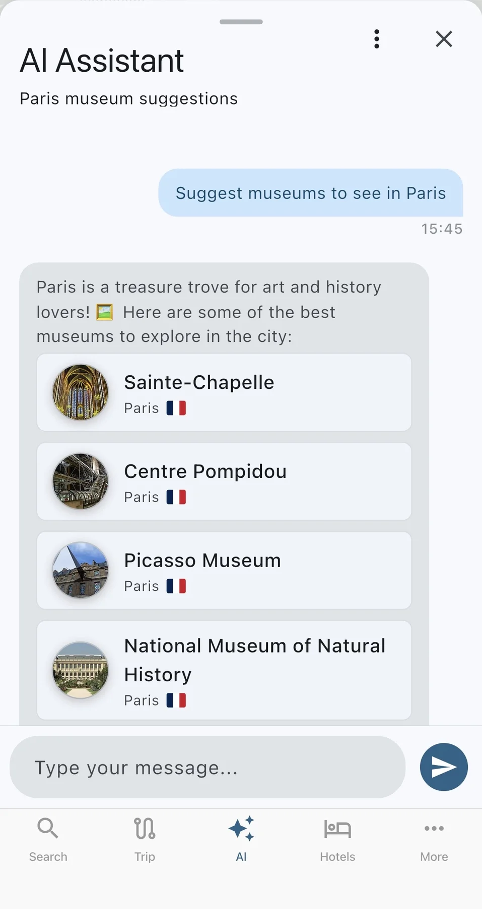

## What it can do

Open the **AI** tab. With a Premium subscription the assistant can:

- **Plan**: build whole days around your places, create a trip, extend it.
- **Change your trip**: add, move, remove and reorder places; set hotels and flights; rename days; optimize a day's order.
- **Answer questions**: opening hours, routes, weather and climate, travel alerts, exchange rates, ideas for what to do.
- **Search** places, hotels, tours, flights and audio tours.
- **Use your files**: attach a booking confirmation or ticket and it adds the details to your trip.

The **⋮** menu in the AI panel has **Start new conversation**, **Recent conversations**, **Memory context**, **Report conversation** and **Delete conversation**.

## On the free plan

The AI panel shows **Try a sample question**. Pick one and you see the assistant's first answer. Custom questions and follow-ups need [Premium](/premium/free-vs-premium/). The [7-day free trial](/premium/free-trial/) includes the full assistant.

Free accounts also get 3 [AI day plans](/ai/plan-this-day/) a day, which are a separate feature.

## Lifetime licence owners

Your lifetime licence keeps its Premium features. The assistant comes with the [AI upgrade](/premium/lifetime-and-ai-upgrade/).

## Prefer your own AI?

You can also connect Claude, ChatGPT and other assistants to your trips: [Connect your AI](/ai/connect-your-ai/).
