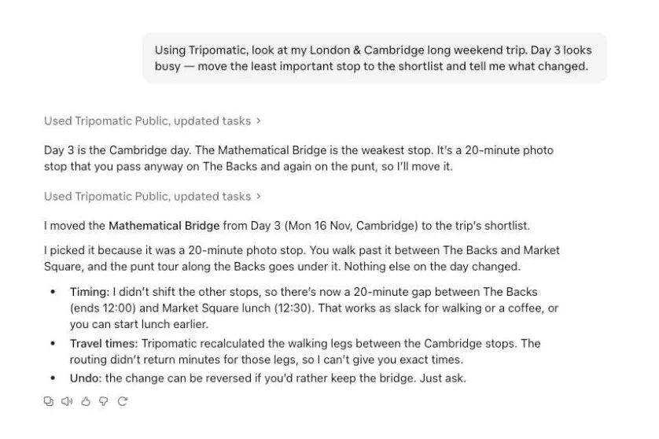

Tripomatic works with AI assistants through the **Model Context Protocol (MCP)**. You need a Tripomatic account; guest accounts cannot connect. Full guide with screenshots: [tripomatic.com/en/connect-ai](https://tripomatic.com/en/connect-ai).

**Server address (the same for every assistant):** `https://mcp.tripomatic.com/mcp`

## Claude (web, desktop, mobile)

1. Open **Settings › Connectors** and choose **Add custom connector**.
2. Name it **Tripomatic** and paste the address.
3. Tap **Add**, then **Connect**, sign in to Tripomatic and approve access.

**Claude Code:** run `claude mcp add --transport http tripomatic https://mcp.tripomatic.com/mcp`, then `/mcp` and choose Tripomatic to sign in.

## ChatGPT

1. Go to **chatgpt.com/plugins**, tap **+** and choose **Add custom MCP server**.
2. Enter a name and the address, choose OAuth, and confirm.
3. Create it as a plugin and sign in to Tripomatic.
4. In a chat, type `@` and pick **Tripomatic**.

Availability depends on your ChatGPT plan, region and workspace settings.

## Gemini, Grok and others

- **Gemini**: Settings › Connected apps › add a custom app (currently personal accounts, US, English).
- **Grok**: grok.com/connectors › New Connector › Custom, then paste the address.
- **Any other assistant**: look for Connectors, Connected apps, Plugins, Tools or Integrations that accept a server address.

## What it can do

- **Read**: your trips (including shared ones), favorites, attachments, your plan and usage.
- **Change**: add, move and remove places and notes, add days, set stays, create a trip, change its title and dates, update favorites, save a file, export a trip (Premium).
- **Look up**: weather, travel alerts and public holidays.
- **Cannot**: delete a trip, share or invite, buy anything, or edit trips you can only view.

## Undo

Changes apply immediately and appear in the trip's [Version history](/planning/version-history/), where they can be undone for **180 days**. You can also ask the assistant to undo them.
