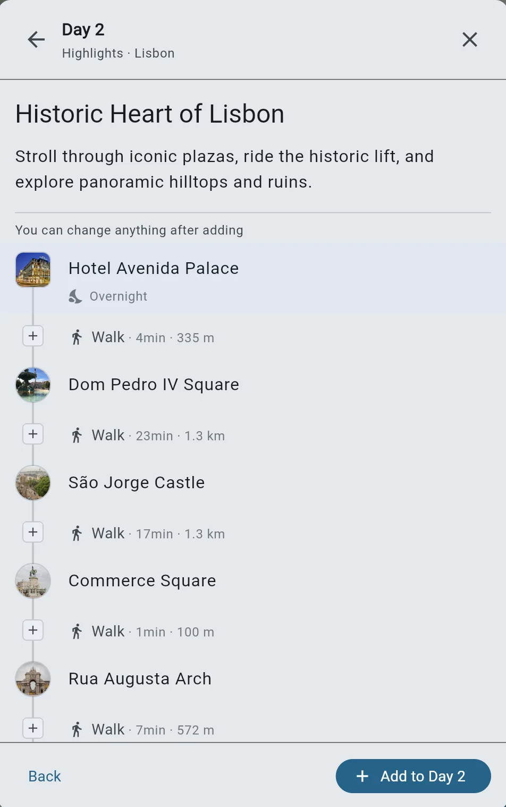

## Plan an empty day

1. Open an empty day in your trip and tap **Plan this day** ("Pick a theme or an audio tour"). It is also in **Add to Day N** under "Find places".
2. **Where**: choose **Stay in …** to plan around where you are, or **Day trip** to get a few nearby destinations to pick from.
3. **Kind of day**: tap **Highlights** or **Audio tour** for a one-tap plan, or mix up to three themes: Outdoors, Museums, Architecture, Food, Shopping, Entertainment, With kids, Parks and pools, Wine, Winter activities. Then tap **Plan …**.
4. Review the preview: ordered stops with routes. Tap **Add to day N**, or **Back** to try another theme.

The plan has no times; set them afterwards if you want. "You can change anything after adding."

If you see **Add where you stay to plan this day**, add a hotel or a start location first.

## Plan days from your shortlist

When the trip's [Shortlist](/planning/add-places/#the-shortlist) has two or more places, a card **Plan days from your shortlist** appears under it.

1. Tap it and select the places to schedule, then **Schedule N places**.
2. The planner finds the right days, considering opening hours, distance from where you stay and how full each day is. The preview explains anything it could not place, such as "Closed on every day of your trip".
3. Tap **Add N places to M days**. One step in [Version history](/planning/version-history/) undoes it.

## Limits

- **Free accounts** (and lifetime licences): **3 AI day plans per 24 hours**, shared between Plan this day and the shortlist planner. The card shows how many are left. On the free plan, plans are shortened to fit the 25 places per trip.
- **Premium subscription**: plan as many days as you like.
- **Audio tour** plans are always free.
