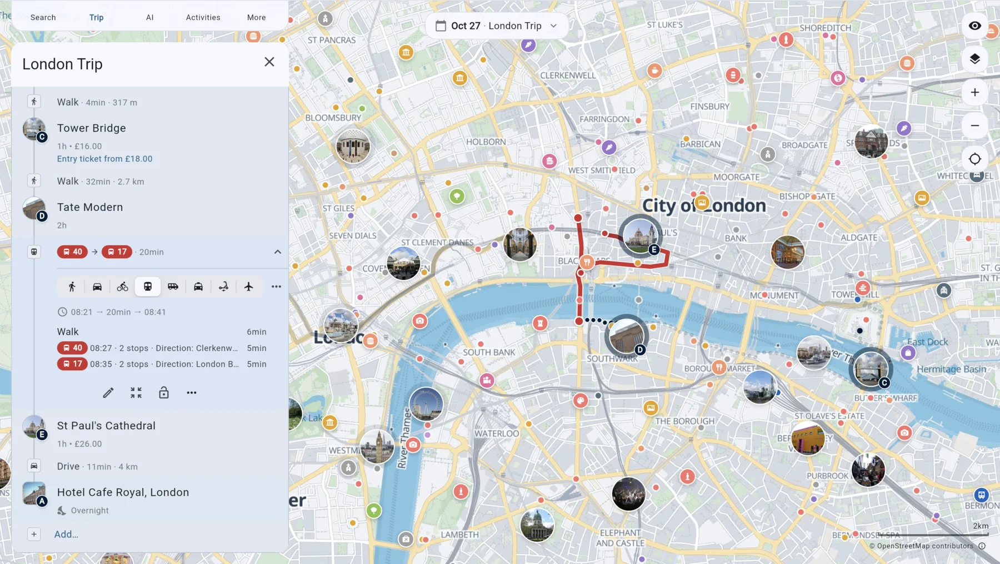

## 1. Create the trip

1. Open **More › My Trips** and tap **Plan a New Trip** (or **Create New Trip** if you already have trips). You can also tap an empty date in the **Trip** tab.
2. **Destination**: type a city or region under "Where are you going?", or pick one of the popular destinations. You can add more destinations later, or tap **Skip**.
3. **Dates**: choose a start date and the number of nights, then tap **Continue**. You can change them later.
4. **Overview**: optionally **Add accommodation** and **Add flight** (by flight number or route). Tap **Create Trip**.

The trip opens in the **Trip** tab: a week calendar at the top, then the selected day.

> **Tip:** Not sure where to go? Choose **Suggest a Trip with AI** instead of Plan a New Trip.

## 2. Fill the days

- **From the map or search:** open any place and tap **Add to trip**. Pick the day and where in the day it should go, then **Add here**. See [Add places to your trip](/planning/add-places/).
- **From inside a day:** tap **Add to Day 1** at the end of the day and search, pick from the map, or add a flight or free time.
- **With AI:** on an empty day, tap **Plan this day** and choose a theme such as Highlights, Food or Museums. See [Plan this day](/ai/plan-this-day/).
- **Not sure which day yet?** Save places to the **Shortlist** (bookmark icon) and schedule them later.

Routes between consecutive places are added for you. Each day ends with a **Day summary** showing the estimated duration, distances and cost.

## 3. Where the trip starts and ends

If you saved a home address in **More › Frequent Locations**, new trips start and end there. Otherwise the first day shows **Add start location** and the last day **Add destination**; tap them to set an airport, station or hotel.

## Next steps

- [Set times, durations and notes](/planning/times-and-notes/)
- [Add hotels](/planning/hotels/) and [tours](/planning/tours-and-activities/)
- [Share the trip](/sharing-and-export/share-a-trip/) with your travel companions
