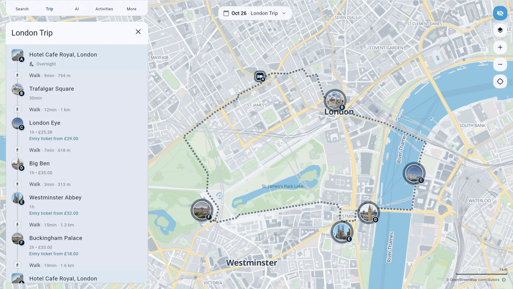

Tripomatic is a trip planner. You choose where and when you are going, then put places into days. The app shows each day on a map with the routes between stops, travel times and a day summary.

## What you can do

- **Plan day by day.** Add sights, restaurants, hotels and your own places, reorder them by dragging, set visit times and notes. See [Add places to your trip](/planning/add-places/).
- **Get there.** Routes between stops are calculated for walking, driving, cycling and public transport; flights and trains can be added too. See [Transport between places](/planning/transport/).
- **Plan with AI.** Let the AI build a day around a theme, or ask the assistant to change your trip. See [Plan this day](/ai/plan-this-day/).
- **Travel safely.** Travel alerts (advisories, weather, strikes) and public holidays appear on the days they affect. See [Travel alerts](/on-the-road/travel-alerts/).
- **Book.** Find hotels (via Stay22) and tours (via GetYourGuide) next to your plan.
- **Share.** Invite people to view or edit the trip with you.
- **Take it with you.** Offline maps, PDF export, live flight status and a home-screen widget (some are Premium).

## Where it runs

| Platform | How to get it |
|---|---|
| iPhone and iPad | App Store: search "Tripomatic" |
| Android | Google Play: search "Tripomatic" |
| Any computer | [maps.tripomatic.com](https://maps.tripomatic.com/) in your browser |

One account works everywhere, and trips sync automatically: [How syncing works](/account/sign-in-and-sync/).

Looking for guided audio walks? That is a different app: [Tripomatic Audio Guides](/audio-guides/what-is-audio-guides/).
