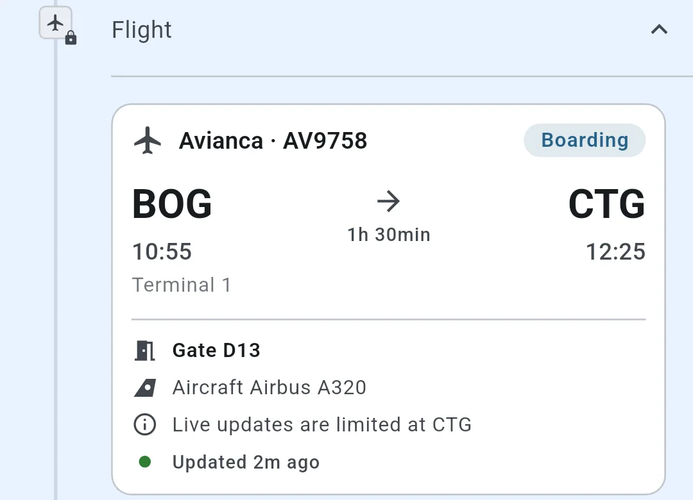

## Add your flight

Add the flight to the right day with **Add to Day N › Flight** and search by flight number. Flights you enter manually have no live status. See [Add flights](/planning/transport/#add-a-flight).

## What you see

From **24 hours before departure** until a few hours after arrival, the flight card shows:

- status: On time, Delayed (with the delay), Canceled, Diverted, Rescheduled, Check-in open, Boarding, Gate closed, In flight, Landed;
- terminal, gate, check-in desk and baggage belt;
- aircraft type and when it was last updated.

## Pushes

On iPhone and Android, Premium subscribers get a notification when the flight changes, for example a delay of 15 minutes or more or a cancellation. Allow notifications in **More › Settings › Daily summary & alerts**.

Tracking someone else's flight without a trip? Try the [flight tracker](https://tripomatic.com/en/features/flight-tracker) on tripomatic.com.
