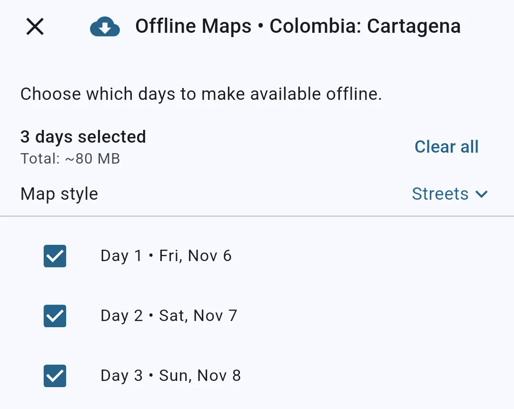

## Download

1. Open the trip and tap **⋮ Trip menu › Offline Maps**.
2. Tick the days to make available offline (**Select all** / **Clear all**).
3. Choose the **Map style**. The total download size is shown.
4. Tap **Download**. Keep the app open and connected until it finishes. One trip downloads at a time.

You can also turn on **Available offline** for a single day from its header, or tap **Manage offline data for the whole trip**.

When done, each day shows the style, size and **Available offline until …**. Use **Refresh** to update or **Delete** to remove.

## Good to know

- Maps cover the area **around the places in each day**. Days with no places yet get nothing, so plan first and download last.
- Downloads are removed automatically **30 days after the trip ends**.
- The map style cannot be changed after the first download; delete and download again to switch.
- Typical sizes: Minimal is smallest, Streets about twice that, Outdoor and Winter about four times.

## Free up space

**More › Settings › Maps and Cache** shows how much space offline maps use. **Clear Maps and Cache** removes all of them.
