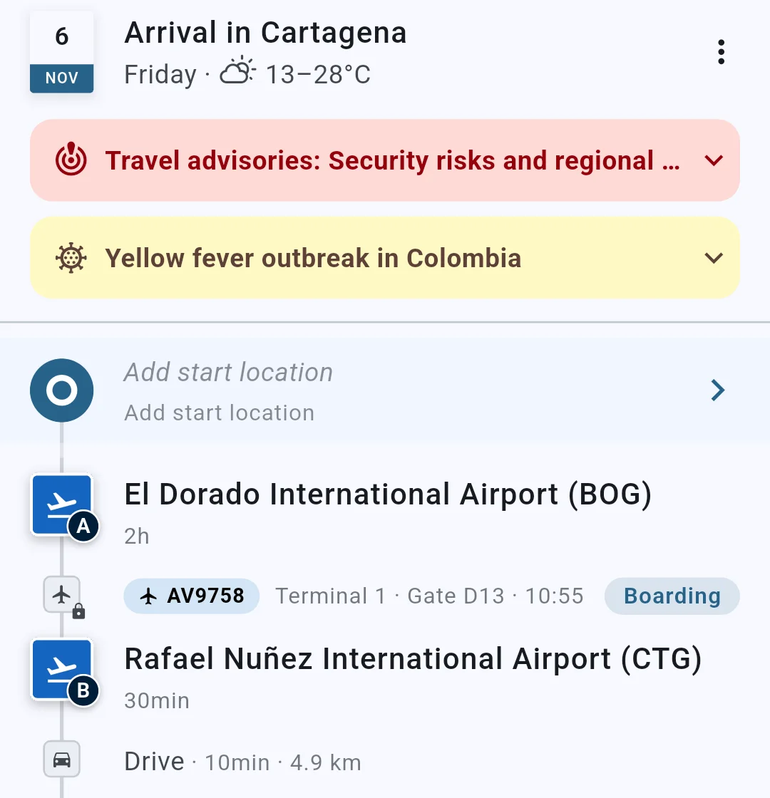

## Where you see alerts

- **On your trip days**, from today up to 30 days ahead, as coloured boxes above the itinerary.
- **On destinations**, in a **Travel alerts** section at the top.

Tap an alert to expand it; **See more** opens **Alert details** with the issuing source, when it was issued, how long it is valid, the area it applies to, and **Read more** on the source's site. Alerts need an internet connection.

Types include travel advisories, entry and health requirements, security and civil unrest, weather warnings, tropical cyclones, floods, earthquakes, tsunamis, volcanoes, wildfires, air quality, avalanche danger, outbreaks, strikes, transport disruption, outages and mass events.

## Notifications (iPhone and Android)

- **Daily summary** (free): an evening push about tomorrow on your trip, and an email the day before your trip starts.
- **Danger alerts** (Premium subscription): a push when a dangerous situation affects your trip. Less urgent alerts wait for the daily summary. Pushes for "danger" respect quiet hours (22:00–08:00 local time); "immediate danger" does not.

To get them, allow notifications: **More › Settings › Daily summary & alerts › Allow notifications**. To stop them, turn notifications off for Tripomatic in your phone's settings.

Lifetime licence owners get danger pushes with the [AI upgrade](/premium/lifetime-and-ai-upgrade/).
