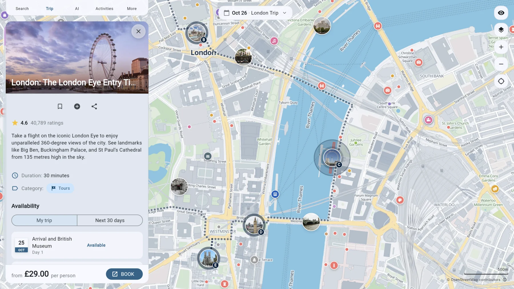

## Find a tour

1. Tap **Activities** in the main menu. The panel is titled **Tours & activities**.
2. Choose **Your trip** to see activities for all your destinations, or **On the map** for the area you are looking at.
3. Browse **Tickets**, **Guided Tours** and **Day Trips**, search, sort and filter. **For your trip** suggests activities linked to places on your days.
4. Open an activity for its description, what is included, the meeting point, reviews and an **availability** calendar with your trip days marked.

Inside a day you may also see ticket suggestions next to places, such as "Entry ticket from …". You can hide them for a place or for the whole trip.

## Book

Tap **Book**. GetYourGuide opens with the date you picked in the availability calendar, where you choose the option and pay.

## Add it to your itinerary

Tap **Add to trip** on the activity. It lands on the day you picked in the availability calendar, at its start time. Edit the meeting point and notes with **Notes › Edit Tour**.
