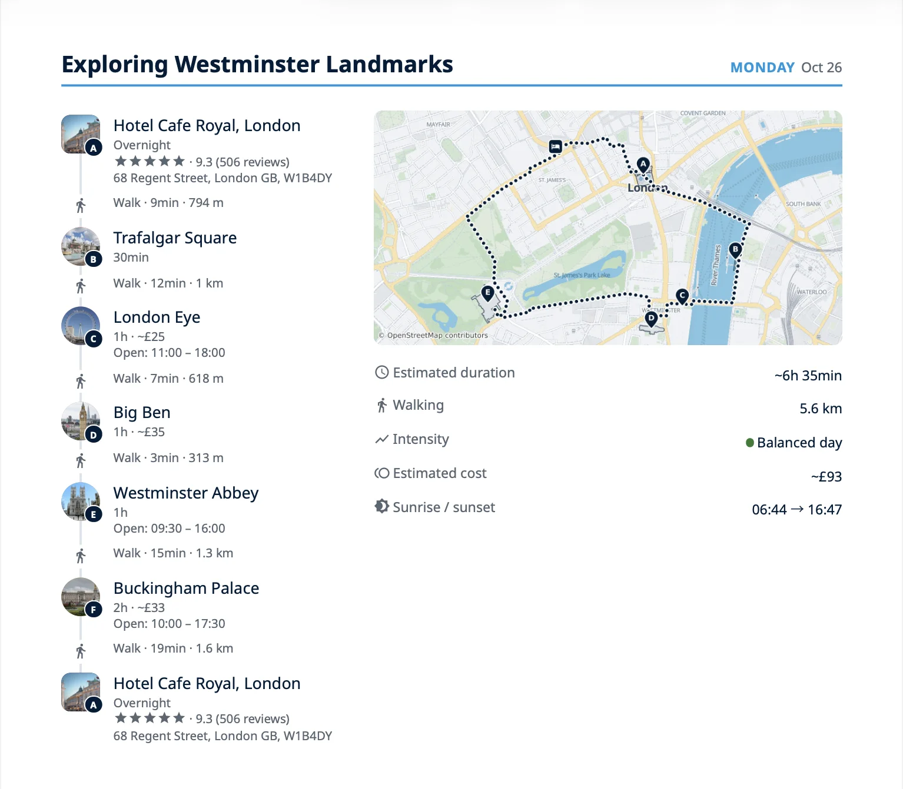

## PDF

1. Open the trip and tap **⋮ Trip menu › Export Trip**.
2. Under **Export as PDF**, tap **Generate PDF**.
3. You see "Waiting in queue…", then "Generating PDF…". Long trips can take several minutes. You can close the panel; the PDF waits there, and we **email it to you** when it is ready (and send a push on phones).
4. When **Your PDF is ready**, tap **Preview**, **Save** or **Share**. Print it from the PDF viewer.

The PDF is A4 and contains each day's itinerary, a map, photos and place details. If you change the trip later, the panel says so and offers **Generate again**.

## GPX

**Export as GPX** gives your route as GPS tracks for a watch, bike computer or apps like Garmin, Komoot or Strava. Choose **All days in single file** or **One file per day (ZIP)**, then **Download GPX**.

## KML

**Export as KML** opens your trip as a map in Google Earth or Google My Maps. Tap **Download KML**.

## Who can export

Export needs [Premium](/premium/free-vs-premium/), either a subscription or a lifetime licence.
