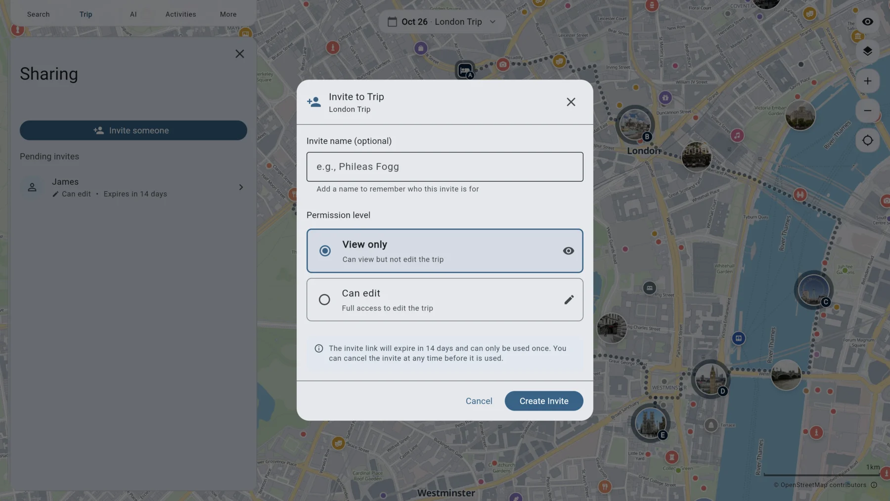

## Invite someone

1. Open the trip and tap the **⋮** Trip menu › **Trip Sharing**.
2. Tap **Invite someone**.
3. Optionally type a name to remember who the invite is for.
4. Choose the **Permission level**:
   - **View only**: can see the trip but not change it (default).
   - **Can edit**: can change everything you can, except sharing and deleting the trip.
5. Tap **Create Invite**, then **Share** or **Copy link** and send it.

Each invite link works **once** and **expires after 14 days**. Pending invites are listed in **Trip Sharing**, where you can cancel them.

## Accept an invite

Open the link and tap **Accept Invitation**. Or open **More › My Trips › ⋮ › Accept Invite** and paste the link. The trip appears in your trip list.

## Manage people

In **Trip Sharing**, tap a person under **Shared with** to change their display name, switch between **View only** and **Can edit**, or **Remove access**.

## Good to know

- Changes appear for everyone almost immediately.
- Only the owner can invite people, delete the trip and upload or link attachments. Attachments linked to the trip are visible to everyone invited.
- People who can view only see "You're viewing a shared trip — only the owner can make changes."
- A collaborator can **Leave Trip** from Trip Settings.
