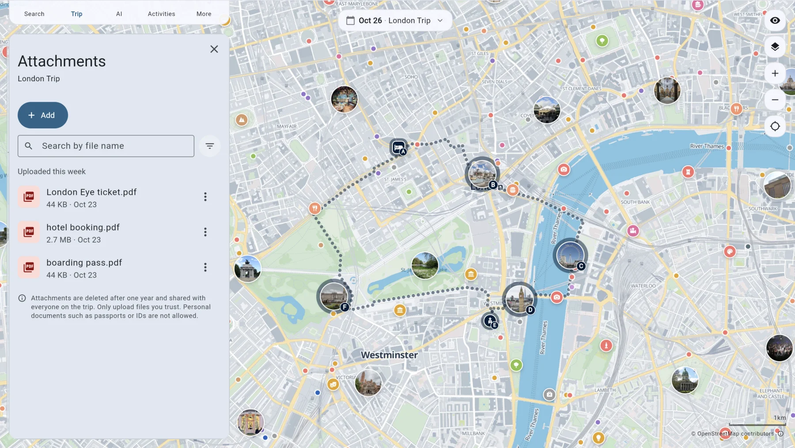

## Upload a file

1. Open **⋮ Trip menu › Attachments** (files for this trip) or **More › Attachments** (all your files).
2. Tap **Add** and choose **Choose from Files**. On a phone you can also **Take a photo** or choose from your photos. On the web, drag files onto the panel.
3. The first time, read **Before you upload** and tap **I understand**.

You can also share a file to Tripomatic from another app (**Save to attachments**, optionally **Link to a trip**), or attach it in the AI chat.

**Accepted:** PDF, JPG, PNG, WebP, HEIC, TXT, CSV, Markdown, Word, Excel, PowerPoint, OpenDocument, RTF, HTML, EML and ICS files, up to **50 MB** each. Converted documents can have up to 100 pages.

## Link, share and remove

- A file can be linked to one or several trips. **Unlink** keeps the file; **Delete** removes it permanently.
- Files linked to a shared trip are visible to everyone in it. Linking asks **Share with the trip's travellers?** first.
- Only the trip owner can upload and link files; collaborators can open them.

## Let the AI read it

Choose **Process with AI Assistant** on a file. The assistant reads bookings, plans and notes and applies them to your trip, for example a hotel stay or a flight.

## Who can upload

Uploading needs an active **Premium subscription**. Free accounts and lifetime licences (without the [AI upgrade](/premium/lifetime-and-ai-upgrade/)) see the files shared with them but cannot upload.
